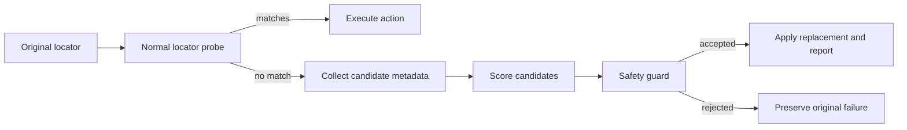

# Playwright Self-Healing Locator Engine

A Java locator-healing layer for Playwright that scores candidate elements, applies conservative safety checks, stores baselines, and reports each decision. The core logic is designed to be unit-testable without a private application.

Publication approval was obtained for this sanitized portfolio version. Private application names, URLs, credentials, locator history, screenshots, and reports are excluded.

## What this demonstrates

- Deterministic candidate scoring across stable element metadata.
- A safety guard that rejects ambiguous or low-confidence replacements.
- Separate core interfaces for drivers, stores, context, and event reporting.
- JSON-backed healing history with explicit test coverage.
- Playwright adapters that keep page objects unchanged while adding healing behavior.

## Tech stack

Java 17, Maven, Playwright, TestNG, Allure TestNG, Gson/Jackson, Log4j2, Lombok, and AspectJ. Exact versions are recorded in `pom.xml`.

## Architecture

```text
src/main/java/com/portfolio/selfhealing/
├── healing/core/       scoring, decisions, safety, storage, and interfaces
├── healing/playwright/ Playwright locator adapters and proxies
├── healing/report/     Allure and event reporting
├── listeners/          TestNG lifecycle integration
├── pages/              example page objects
└── utils/              configuration and browser lifecycle
src/test/java/com/portfolio/selfhealing/
├── healing/core/       pure unit tests for the algorithm
└── healing/            local fixture and integration-style tests
```



## Algorithm and design decisions

The engine tries the original locator first. Only a no-match result can trigger healing. Candidate metadata is scored using stable signals such as role, accessible name, label, test id, text, and container context. A candidate must meet the confidence threshold, beat the next different candidate by the configured margin, be enabled, and resolve to exactly one element. Presence checks, reads, hidden-state waits, and short explicit probes are intentionally excluded from healing because changing their behavior could hide application defects.

## Coverage and status

A source scan found 20 test files and 92 `@Test` methods. The repository includes unit tests for similarity scoring, selector hints, safety rules, JSON storage, healing decisions, and a local fixture. The private application-specific tests remain environment-dependent and are documented as such.

## Setup and run

1. Install Java 17 and Maven.
2. Copy `src/test/resources/config.local.properties.template` to the ignored local config file and set credentials only through environment variables or that untracked file.
3. Run `mvn -q -DskipTests compile`.
4. Run the pure core tests with the relevant TestNG suite. Full application flows require a compatible environment.

Healing history and Allure output are runtime artifacts and are ignored. No historical locator data is published.

## Limitations and next steps

Healing is a safety-conscious stopgap, not a substitute for repairing selectors. The next improvements would be a small public fixture matrix, mutation tests for ambiguous candidates, and a provider-neutral browser adapter.

## AI assistance

The engine was developed with AI assistance. The author is responsible for the design, review, sanitization, and execution claims; no claim is made that every line was typed manually.
